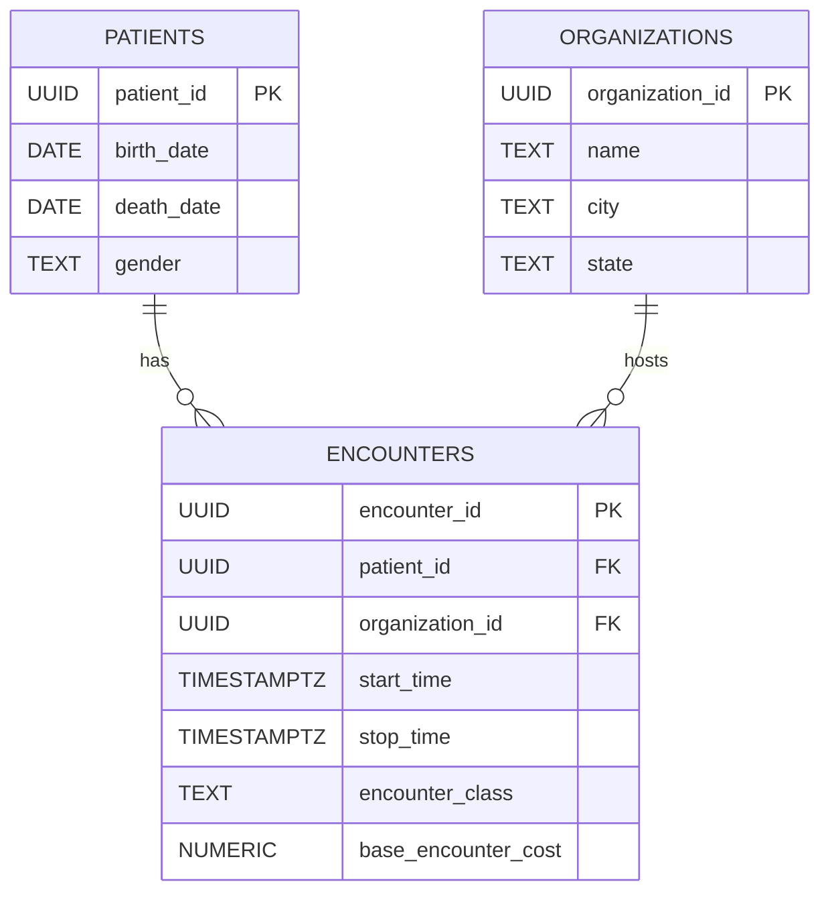
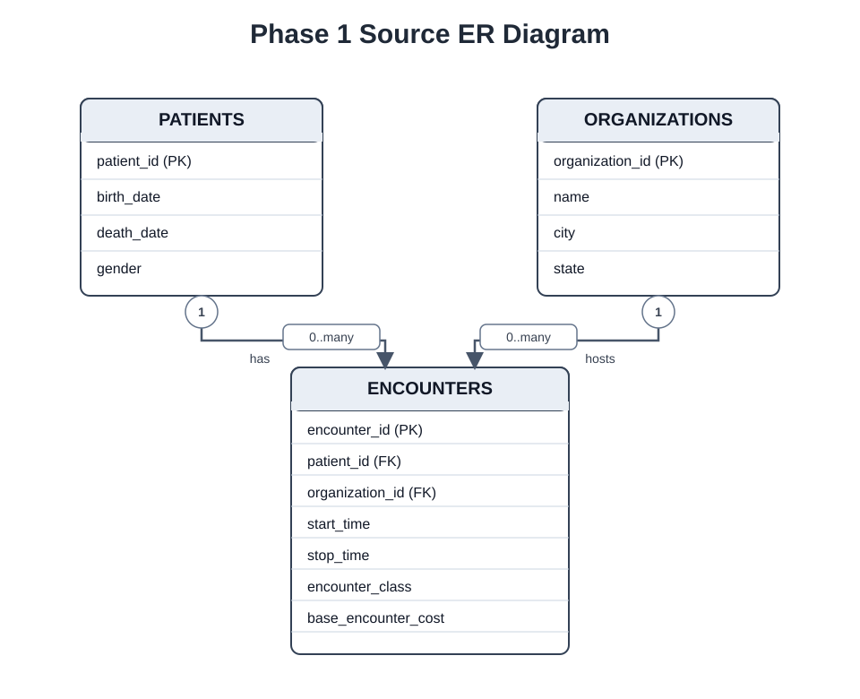

# Phase 1 ER Diagram

We have 3 tables: `source.patients`, `source.organizations` and `source.encounters`. One encounter is associated with one patient and one organization. One patient or one organization may have several encounters (including zero).

`PK` is primary key, `FK` is foreign key. Only `death_date`, `state` and `stop_time` may be NULL. Each encounter has an id of its own, so that one patient may have more than one encounter at the same organization.

